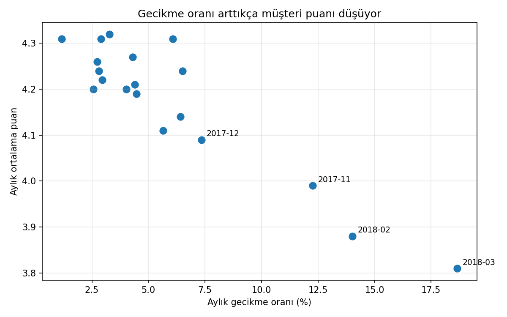
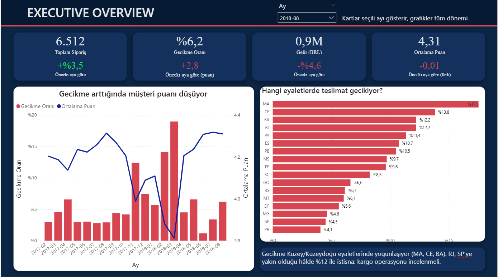
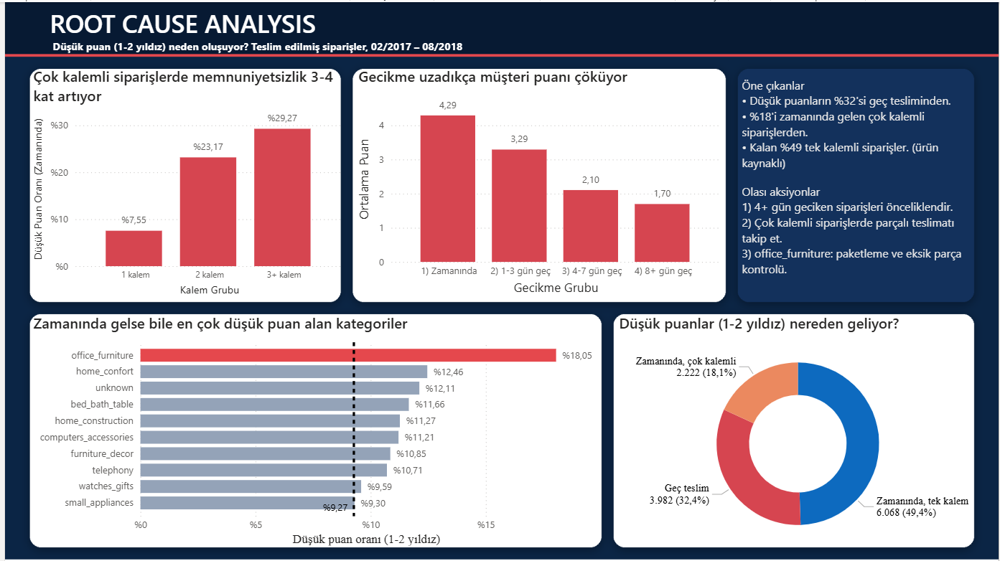

# Olist E-Ticaret: Geç Teslimat Müşteri Memnuniyetini Nasıl Etkiliyor? (SQL Server, Python, Power BI)

> **English summary:** End-to-end analysis of the public Olist Brazilian e-commerce dataset (99k orders, 2017-02 to 2018-08). I cleaned the raw tables in SQL Server (T-SQL views, with a documented data-quality log), tested hypotheses in Python (Pearson/Spearman, Mann-Whitney), and built a 2-page Power BI dashboard (DAX, prior-period comparison, root-cause page). Main finding: late deliveries are 6.8% of delivered orders but account for 32% of 1-2 star reviews; multi-item orders and the office_furniture category explain a large part of the rest. Findings are correlational and flagged as hypotheses where the data cannot prove a cause.

## Amaç
Ham, temizlenmemiş bir e-ticaret verisiyle bir analistin izleyeceği sırayı uygulamak:
1. **Veriyi doğrulamak ve temizlemek** (SQL Server, T-SQL)
2. **Sorulara istatistikle cevap aramak** (Python)
3. **Sonucu karar vericiye sunmak** (Power BI dashboard)

Ana soru: **Müşteri neden düşük puan (1-2 yıldız) veriyor, ve bunun ne kadarı teslimat gecikmesinden geliyor?**

## Veri seti
Olist, Brezilya'daki bir pazaryeri platformunun herkese açık sipariş verisidir (Kaggle). 9 tablo + kategori çeviri tablosu içerir: müşteriler, siparişler, sipariş kalemleri, ödemeler, yorumlar, ürünler, satıcılar, coğrafi konum.

| | |
|---|---|
| Sipariş sayısı | 99.441 |
| Sipariş kalemi | 112.650 |
| Teslim edilen sipariş | 96.470 |
| Analiz penceresi | 2017-02 → 2018-08 (19 ay, 98.292 sipariş) |
| Para birimi | BRL |

**Analiz penceresi neden 2017-02 → 2018-08?** 2016 (toplam 329 sipariş) ve 2017-01'de platform henüz oturmamıştı, 2018-09/10'da ise sadece 20 sipariş var. Bu aylarda oranlar küçük sayılardan dolayı oynak, bu yüzden pencerenin dışında bıraktım (2017-01 yalnızca 2017-02'nin "önceki ay" karşılaştırması için kullanılıyor).

## Mimari

```
Ham tablolar (dokunulmadı)
   └─ Temiz view'lar (SQL Server): vw_products_clean, vw_orders_clean, vw_order_reviews,
      vw_order_items_clean, vw_order_category, vw_order_analysis
         ├─ Python: istatistik testleri (pandas, scipy, SQLAlchemy)
         └─ Power BI: veri modeli + DAX + 2 sayfalık dashboard
```

Ham tabloları değiştirmedim, tüm temizlik **view'lar** içinde yapıldı. Böylece her karar izlenebilir ve geri alınabilir.

## 1. Veri kalitesi günlüğü

| # | Sorun | Nasıl fark ettim | Karar | Etki |
|---|---|---|---|---|
| 1 | Kategori çeviri tablosunda başlık satırı veri olarak yüklenmiş (sütunlar `column1`, `column2`) | Satır sayısı ve sütun adları kontrolü | Başlık satırı silindi, sütunlar yeniden adlandırıldı | 71 satır |
| 2 | Kategori `bilinmiyor` | Eksik değer taraması | `unknown` olarak etiketlendi | 610 ürün |
| 3 | İki kategorinin çevirisi yok | Çeviri birleşiminde NULL | Elle çevrildi (`portable_kitchen_food_preparers`, `pc_gamer`) | 2 kategori |
| 4 | Eksik değerler `0` ile doldurulmuş (ad uzunluğu, açıklama uzunluğu, fotoğraf sayısı) | Sıfır değer taraması | `NULL` yapıldı (sahte sıfır ortalamaları bozmasın) | 610 ürünün fotoğraf sayısı NULL |
| 5 | **Para sütunları ×100 yüklenmiş** (`price`, `freight_value`, `payment_value`) | Mantık kontrolü: toplam gelir 1,36 milyar, ortalama fiyat 12.065 çıktı | `/ 100.0` ile düzeltildi | Toplam ürün geliri **13.591.643,70 BRL**, iki ayrı view'da aynı çıktı |
| 6 | Bir siparişe birden fazla yorum | `order_id` bazında sayım | Son yorum tutuldu (`ROW_NUMBER`) | 547 sipariş, sonuç 98.673 puanlı sipariş |
| 7 | Boş metin yorumlar (`''`) | Metin sütunu kontrolü | `NULL` yapıldı | — |
| 8 | Durumu `delivered` ama teslim tarihi boş | Durum / tarih çapraz kontrolü | Gecikme analizinden çıkarıldı | 8 sipariş |
| 9 | **Satır çoğalması:** siparişin birden fazla kalemi, ödemesi, yorumu olabiliyor | Birleşim sonrası satır sayısı kontrolü | Kalem, ödeme ve yorum önce **sipariş düzeyine toplandı**, sonra birleştirildi | `vw_order_analysis` = 99.441 satır, sipariş başına 1 satır |
| 10 | Küçük aylarda yüzde değişim anlamsız (örn. 1 siparişlik ayda -%100) | Aritmetik taşma hatası ve mantık kontrolü | Yüzde değişim yalnızca önceki ay ≥ 100 siparişse hesaplanıyor | Hem SQL hem DAX |

**Gecikme tanımı:** durumu `delivered` ve teslim tarihi dolu bir sipariş, teslim tarihi (gün düzeyinde) tahmini tarihten sonraysa **geç** sayılır. Saat düzeyinde değil gün düzeyinde karşılaştırdım, çünkü tahmini teslim tarihi gün olarak veriliyor.

## 2. Bulgular

> Düşük puan = 1-2 yıldız. Aksi belirtilmedikçe teslim edilmiş ve puanlı siparişler.

### 2.1 Gecikme ve memnuniyet
- Teslim edilen siparişlerin **%6,77'si** (6.534 / 96.470) tahmini tarihten sonra geldi.
- Gecikme süresi arttıkça puan düşüyor:

| Gecikme | Ortalama puan |
|---|---|
| Zamanında | **4,29** |
| 1-3 gün geç | 3,29 |
| 4-7 gün geç | 2,10 |
| 8+ gün geç | **1,70** |

- Zamanında gelen 89.443 siparişte düşük puan oranı **%9,3**, geç gelen 6.381 siparişte **%62,4** (Mann-Whitney U, p < 0,001; ortalama puan 4,29 vs 2,27).
- Geç siparişler teslimatların yalnızca %6,7'si ama **düşük puanların %32,4'ünü** oluşturuyor (3.982 / 12.272).

### 2.2 Zaman içinde
Aylık gecikme oranı ile aylık ortalama puan arasında güçlü negatif ilişki var (n = 19 ay):

| Ölçü | Değer |
|---|---|
| Pearson r | **-0,92** (p < 0,0001) |
| Spearman rho | **-0,68** (p = 0,0013) |



İki değer arasındaki fark bilinçli bir uyarı: Pearson, üç uç ay (2017-11, 2018-02, 2018-03) tarafından şişiyor. Spearman sıralamaya baktığı için daha temkinli bir ölçü, ikisini birlikte raporluyorum.

| Ay | Gecikme | Ortalama puan | Not |
|---|---|---|---|
| 2017-11 | %12,4 | 3,99 | Sipariş sayısı önceki aya göre **+%62,9** (hacim sıçraması) |
| 2018-02 | %14,1 | 3,88 | |
| 2018-03 | %19,0 | 3,81 | Sipariş hacmi önceki aya göre yalnızca +%7,2 artmışken gecikme sıçradı: operasyonel neden araştırılmalı |
| 2018-04 | %4,5 | 4,21 | Gecikme düzelince puan hemen toparlandı |

### 2.3 Bölge
Yeterli hacmi olan (≥ 500 sipariş) 17 eyalet içinde gecikme oranı: **MA %17,5**, **CE %13,8**, **BA %12,2**, **RJ %12,2**; SP %4,5, MG %4,6, PR %4,1.
- Gecikme **Kuzey/Kuzeydoğu** eyaletlerinde yoğunlaşıyor. Satıcıların çoğunun SP çevresinde olduğu düşünülürse uzaklık makul bir açıklama (**hipotez**, veriyle kanıtlanmadı).
- **RJ istisna:** SP'ye yakın olduğu hâlde Kuzeydoğu seviyesinde gecikme var, uzaklıkla açıklanamıyor. Kargo/son kilometre operasyonu ayrıca incelenmeli.

### 2.4 Gecikme dışında ne var? Çok kalemli ve çok satıcılı siparişler
Zamanında gelen siparişlerde bile:

| Kalem sayısı | Sipariş | Düşük puan |
|---|---|---|
| 1 | 80.407 | **%7,55** |
| 2 | 6.935 | **%23,17** |
| 3+ | 2.101 | **%29,27** |

Çok kalemli siparişler zamanında teslimatların %10'u ama zamanında gelen siparişlerdeki düşük puanların yaklaşık **%27'sini** oluşturuyor (2.222 / ~8.290). Satıcı sayısı etkiyi güçlü şekilde ayırıyor:

| Kategori / Satıcı | Sipariş | Düşük puan |
|---|---|---|
| 1 kategori, 1 satıcı | 88.027 | %8,71 |
| 1 kategori, 2+ satıcı | 659 | **%46,74** |
| 2+ kategori, 1 satıcı | 167 | %21,56 (küçük örneklem) |
| 2+ kategori, 2+ satıcı | 590 | **%47,12** |

> **Hipotez:** Farklı satıcıların ürünleri ayrı paketlerle geliyor, bir kısmı eksik veya geç kalıyor, ama veride siparişe tek bir teslim tarihi var, bu yüzden "zamanında" görünüyor. Veri bunu doğrulamaya izin vermiyor.

### 2.5 Kategori: `office_furniture`
Zamanında teslim edilen, tek kategorili siparişlerde en yüksek düşük puan oranı **`office_furniture`**'da: **%18,05** (1.130 sipariş), genel oran %9,27.
- Çoklu satıcı etkisi değil: siparişlerin neredeyse hepsi tek satıcılı (%17,91).
- Kalem karışımı etkisi küçük: mobilya her kalem grubunda genel oranları görseydi beklenen oran ~%10,8 olurdu. Yaklaşık 8,8 puanlık farkın ~1,5 puanı kalem karışımından, kalanı kategoriye özgü (örneklemler küçük, yaklaşık okunmalı).
- Tek kalemli mobilya siparişlerinde bile oran %14,59, genelin (%7,55) yaklaşık iki katı.
- 40 düşük puanlı yorumun (Portekizce, ilk 40 yorum, rastgele örneklem değil) elle okunmasıyla tekrar eden temalar: **eksik adet** ("2 sandalye aldım, 1 geldi"), **eksik parça**, **hasarlı ürün**, teslim edilmemiş ürün. Yorumlar yön gösterir, kanıt değildir.

### 2.6 Düşük puanlar nereden geliyor?
| Kaynak | Pay |
|---|---|
| Geç teslim | %32,4 (3.982) |
| Zamanında, çok kalemli sipariş | %18,1 (2.222) |
| Zamanında, tek kalemli sipariş | %49,4 (6.068) |

Düşük puanların yaklaşık yarısı gecikme ve çok kalemli sipariş gibi operasyonel, yönetilebilir sebeplerden geliyor. Kalan yarısı zamanında gelen tek kalemli siparişler, bunlar ürün kaynaklı olabilir.

## 3. Önerilen aksiyonlar
1. **4+ gün geciken siparişleri önceliklendir**, bu grupta ortalama puan 2,10 ve 1,70.
2. **Çok kalemli / çok satıcılı siparişlerde** parçalı teslimatı takip et veya müşteriyi bilgilendir.
3. **`office_furniture`** için paketleme ve eksik parça kontrolü yap.
4. **RJ'de** kargo operasyonunu incele (yakınlığa rağmen yüksek gecikme).
5. **2018-03** gecikme sıçramasının nedenini araştır (sipariş hacmi yalnızca %7 artmışken gecikme %19'a çıktı).

## 4. Dashboard (Power BI)




**Sayfa 1 – Executive Overview:** KPI kartları (sipariş, gecikme oranı, gelir, ortalama puan) ve her birinin **önceki aya göre** değişimi (renkli: gecikme artışı kırmızı, sipariş artışı yeşil), aylık gecikme-puan grafiği, eyalet bazında gecikme.

**Sayfa 2 – Root Cause Analysis:** gecikme süresi ve puan, kalem sayısı ve düşük puan, kategori bazında düşük puan (ortalama çizgisiyle), düşük puanların kaynağı (donut).

**Veri modeli:** `vw_order_analysis` (sipariş düzeyi) merkezde; `vw_order_items_clean` (kalem), `vw_products_clean` (ürün), `vw_order_category` (tek kategorili siparişler, 1:1) ve bir `Takvim` tablosu ilişkili.

Örnek DAX ölçüleri:

```dax
Gecikme Oranı =
DIVIDE(
    CALCULATE(COUNTROWS(vw_order_analysis), vw_order_analysis[is_delivered] = 1, vw_order_analysis[is_late] = 1),
    CALCULATE(COUNTROWS(vw_order_analysis), vw_order_analysis[is_delivered] = 1)
)

Önceki Ay Sipariş =
CALCULATE([Toplam Sipariş], DATEADD(Takvim[Date], -1, MONTH))

Sipariş Değişim % =
VAR onceki = [Önceki Ay Sipariş]
RETURN IF(onceki >= 100, DIVIDE([Toplam Sipariş] - onceki, onceki), BLANK())

Düşük Puan Oranı (Zamanında) =
DIVIDE(
    CALCULATE(COUNTROWS(vw_order_analysis),
        vw_order_analysis[is_delivered] = 1, vw_order_analysis[is_late] = 0,
        vw_order_analysis[review_score] >= 1, vw_order_analysis[review_score] <= 2),
    [Puanlı Sipariş (Zamanında)]
)
```

**Doğrulama:** Dashboard'daki rakamları SQL sonuçlarıyla tek tek karşılaştırdım (toplam sipariş, toplam gelir, gecikme-puan tablosu, kategori sıralaması). Hepsi birebir tuttu. Küçük kategorilerde uçuk oranlar çıkmasın diye kategori grafiğinde en az 300 puanlı siparişi olan kategoriler arasından en yüksek 10'u gösteriliyor.

## 5. Sınırlar
- **İlişki ≠ neden.** Aylık korelasyon 19 gözleme dayanıyor. Sipariş düzeyindeki testler (96 bin sipariş) ve gecikme gününe göre kademeli düşüş ilişkiyi güçlendiriyor ama nedensellik kanıtlamıyor.
- Verideki sipariş başına **tek teslim tarihi**, parçalı teslimatları göstermiyor. Çok satıcılı sipariş açıklaması bu yüzden hipotez.
- Puan veren müşteriler tüm müşteriler değil (98.673 sipariş puanlı), memnuniyetsiz müşteriler yorum bırakmaya daha yatkın olabilir.
- `office_furniture` yorumları 40 yorumluk, rastgele olmayan bir örneklem.
- Kategori analizi tek kategorili siparişleri kapsıyor (97.880 sipariş), çok kategorili siparişler ayrıca incelendi.
- Aylık karşılaştırmalarda 100 siparişten küçük aylar yüzdeye dahil edilmedi.
- **Performans notu:** View'lar veriyi saklamaz, her sorguda yeniden hesaplanır ve ham tablolarda indeks yok (CSV'den içe aktarıldı). Tüm siparişleri iç içe view'lardan geçiren bir sorgu 5 dakika sürdü, önce `office_furniture` siparişlerine daraltan sorgu 1 saniyede bitti. İyileştirme: anahtar sütunları kısa tipe çevirip indeks koymak ya da `vw_order_analysis`'i tabloya yazdırmak.

## 6. Kullanılan araçlar
SQL Server (T-SQL: CTE, pencere fonksiyonları, `CROSS APPLY`, dinamik SQL), Python (pandas, SQLAlchemy/pyodbc, scipy, matplotlib), Power BI (DAX, zaman zekâsı, koşullu biçimlendirme).

## Klasör yapısı
```
Olist_E_commerce_Analysis/
├─ README.md
├─ SQL Analiz/     # Olist_sql.sql (view'lar, analiz sorguları) + istatistik not defteri (.ipynb)
├─ Dashboard/      # Olist_BL.pbix
└─ assets/         # dashboard ekran görüntüleri, korelasyon grafiği
```
